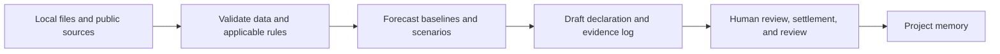

# Bailu Electricity Trading Agent Framework

**A project workspace for power-market data, policy evidence, and office deliverables.**

[简体中文](README.md) · [Agent hosts](docs/agent-hosts.md) · [Trading workflows](docs/trading-workflows.md) · [Knowledge archive](knowledge/ecnote/README.md)

Bailu gives your agent project rules, reusable skills, Chinese electricity-market policies and reproducible Python tools. It works with local data and public read-only sources, keeps an evidence trail, and prepares declaration drafts for human review.

## Deploy in one prompt

Open the destination project in your agent and paste the prompt below.

```
Set up the current folder as a Bailu electricity-trading workspace. Download https://raw.githubusercontent.com/Muguett-DBY/bailu-power-trading/main/scripts/bootstrap.py to a temporary file within the project. If it fails, takes over 15 seconds, or returns a web page, use https://gitee.com/Muguett/bailu-power-trading/raw/main/scripts/bootstrap.py . Verify that the file is Python source. Run it with the existing Git and Python 3.10+ using --project and the absolute path, --mirror github or gitee to match the successful download, and --host if appropriate, such as workbuddy, codex, claude-code, zcode or opencode. Read the project rules and report the installed skill paths and knowledge checks. Keep writes inside this project.
```

The shared skill location is `.agents/skills/`. Use `--host` to add a host-specific location when needed. Hosts that can read local files can also load a skill explicitly through its `SKILL.md`. See [host setup and discovery](docs/agent-hosts.md).

## Workflows



| Task | Entry point |
| --- | --- |
| Register sources and validate market data | `market-data-intake` |
| Forecast prices, spreads, demand, wind, solar, and available supply | `market-forecasting` and [analysis scripts](analysis/README.md) |
| Compare exposures and cost scenarios | `position-monitoring` and settlement skills |
| Prepare a declaration draft and record decisions | `trading-workflow` and `declaration-checklist` |
| Reconcile spreadsheets and PDFs, deliver files | `office-workflow` and [office scripts](office/README.md) |
| Recall preferences and clarify a decision | `project-memory` and `clarify-request` |

[Trading workflow guide](docs/trading-workflows.md) describes the inputs, artifacts, and human review step. Forecasts use historical baselines with measured errors and coverage.

## Update and verify

Ask your agent to update the framework, or run the latest bootstrap with `--project <absolute project path> --check-update`. Use `--update` to apply. Use `--update --host <name>` to add a host to an existing installation. The updater compares the mirrors, checks the candidate in a temporary worktree, and preserves project rules, skill edits, and memory.

The local knowledge includes 892 handbook topics, 151 official documents, 18 verified policy-version records and 2,180 ECNote entries. The issuing authority determines which rule applies on a given date.

```text
python scripts/knowledge_coverage.py --check --format json
```

[Development tests](README.md#开发与复验) · [Agent reference](docs/agent-reference.md) · [MIT license](LICENSE) · [Third-party notices](NOTICE.md)
